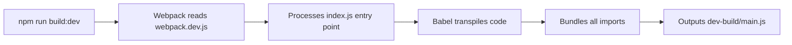
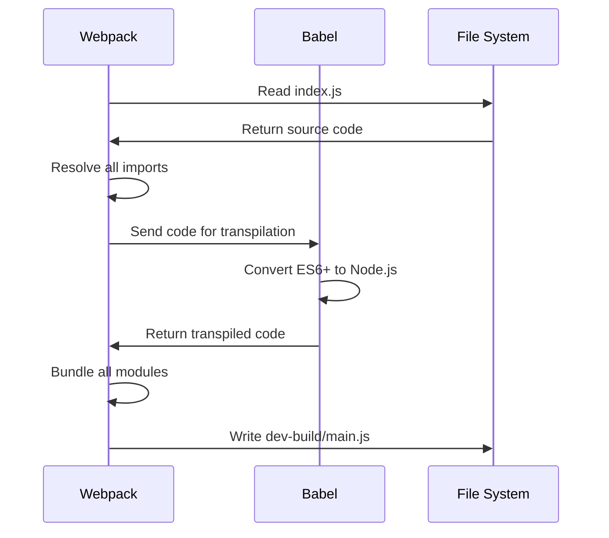
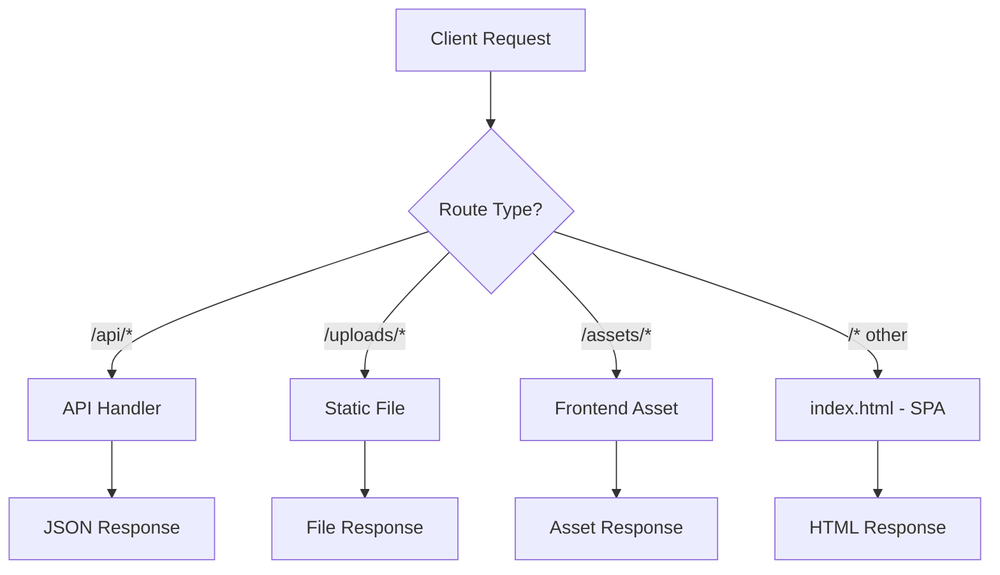

# Production Build Documentation - Marketing Tool Backend

## 📋 Table of Contents

1. [Overview](#overview)
2. [Current Build System](#current-build-system)
3. [How the Build Works](#how-the-build-works)
4. [Build Process Step-by-Step](#build-process-step-by-step)
5. [Deployment Guide](#deployment-guide)
6. [File Structure](#file-structure)
7. [Understanding the Bundled Code](#understanding-the-bundled-code)

---

## Overview

Your Marketing Tool Backend uses **Webpack** and **Babel** to create a production-ready build. The build process:

- ✅ Bundles all JavaScript files into a single `main.js`
- ✅ Transpiles modern JavaScript (ES6+) to Node.js compatible code
- ✅ Excludes `node_modules` from the bundle (installed separately)
- ✅ Serves the frontend React app from the `dist/` folder
- ✅ Provides Socket.IO real-time communication

---

## Current Build System

### Build Command

```bash
npm run build:dev
```

### What Happens



### Build Output

```
dev-build/
└── main.js (129 KB - bundled server code)
```

---

## How the Build Works

### 1. Webpack Configuration ([webpack.dev.js](file:///d:/E/GitHub/Marketing%20tool/Marketing-Tool-Backend/webpack.dev.js))

```javascript
module.exports = {
  entry: {
    main: './index.js',  // Entry point: your main server file
  },
  output: {
    path: path.join(__dirname, 'dev-build'),  // Output directory
    filename: '[name].js',                     // Output: main.js
    clean: true,                               // Clean before each build
  },
  mode: 'development',    // Development mode (not minified)
  target: 'node',         // Target Node.js environment
  externals: [nodeExternals()],  // Exclude node_modules
  module: {
    rules: [
      {
        test: /\.js$/,
        use: 'babel-loader',  // Use Babel to transpile
      },
    ],
  },
};
```

**Key Points:**
- **Entry**: `index.js` - Your main server file
- **Output**: `dev-build/main.js` - Single bundled file
- **Mode**: `development` - Not minified, easier to debug
- **Externals**: `node_modules` are NOT bundled (you need to install them separately)

### 2. Babel Configuration ([.babelrc](file:///d:/E/GitHub/Marketing%20tool/Marketing-Tool-Backend/.babelrc))

```json
{
  "presets": ["@babel/preset-env"]
}
```

**What Babel Does:**
- Converts ES6+ syntax → Node.js compatible code
- Transforms `import/export` → `require/module.exports`
- Ensures compatibility with your Node.js version

### 3. Package Scripts ([package.json](file:///d:/E/GitHub/Marketing%20tool/Marketing-Tool-Backend/package.json))

```json
{
  "scripts": {
    "dev": "kill-port 5000 && nodemon ./index.js",
    "build:dev": "webpack --config webpack.dev.js --mode development",
    "start": "nodemon ./dev-build/main.js"
  }
}
```

**Script Breakdown:**
- `npm run dev` - Run source code directly with hot reload
- `npm run build:dev` - Create bundled build in `dev-build/`
- `npm start` - Run the bundled build with hot reload

---

## Build Process Step-by-Step

### Step 1: Run Build Command

```bash
npm run build:dev
```

### Step 2: Webpack Processes Files



### Step 3: Build Output

```
✓ Webpack compiled successfully in 1150 ms

asset main.js 129 KiB [emitted] (name: main)

Modules processed:
  ✓ ./index.js
  ✓ ./routes/*.js
  ✓ ./controllers/*.js
  ✓ ./models/*.js
  ✓ ./config/*.js
  ✓ ./remote/*.js

External modules (not bundled):
  - express
  - cors
  - socket.io
  - pg
  - multer
  - dotenv
  - @aws-sdk/client-s3
  - csv-parser
```

---

## File Structure

### Source Files (What You Edit)

```
Marketing-Tool-Backend/
├── index.js                    # Main server entry point
├── controllers/                # Business logic
│   ├── csvController.js
│   ├── siteController.js
│   ├── visitController.js
│   ├── marketingPersonController.js
│   ├── remoteController.js
│   └── ...
├── routes/                     # API route definitions
│   ├── csvRoutes.js
│   ├── siteRoutes.js
│   ├── visitRoutes.js
│   └── ...
├── models/                     # Database models
│   ├── siteModel.js
│   └── statusModel.js
├── config/                     # Configuration
│   └── awsConfig.js
├── remote/                     # Socket.IO logic
│   └── remoteSocket.js
└── db.js                       # Database connection
```

### Build Output (Generated)

```
dev-build/
└── main.js                     # Bundled server code (129 KB)
```

### Frontend (Served by Express)

```
dist/                           # React app build
├── index.html
├── assets/
│   ├── index-[hash].js
│   └── index-[hash].css
└── ...
```

---

## Understanding the Bundled Code

### What's Inside `dev-build/main.js`

The bundled file contains:

1. **Webpack Bootstrap Code** (lines 1-377)
   - Module loader
   - Dependency resolution
   - Runtime helpers

2. **Your Application Code** (transpiled)
   - All controllers
   - All routes
   - All models
   - Database connection
   - Socket.IO setup

3. **External References**
   - `require('express')`
   - `require('pg')`
   - `require('socket.io')`
   - etc.

### Example: How Code is Transformed

**Original Code ([index.js](file:///d:/E/GitHub/Marketing%20tool/Marketing-Tool-Backend/index.js)):**
```javascript
const express = require('express');
const cors = require('cors');
const path = require('path');

const app = express();
const PORT = process.env.PORT || 3000;
```

**Bundled Code (dev-build/main.js):**
```javascript
var express = __webpack_require__(/*! express */ "express");
var cors = __webpack_require__(/*! cors */ "cors");
var path = __webpack_require__(/*! path */ "path");

var app = express();
var PORT = process.env.PORT || 3000;
```

---

## Deployment Guide

### Option 1: Deploy Source Code (Recommended for Development)

```bash
# On server
git clone <your-repo>
cd Marketing-Tool-Backend
npm install
npm run dev
```

### Option 2: Deploy Built Code (Production)

#### Step 1: Build Locally

```bash
npm run build:dev
```

#### Step 2: Upload to Server

Upload these files/folders:
```
dev-build/          # Bundled code
dist/               # Frontend build
node_modules/       # Dependencies
uploads/            # User uploads (if needed)
.env                # Environment variables
package.json        # For dependencies
package-lock.json   # Lock file
```

#### Step 3: On Server

```bash
# Install dependencies
npm install --production

# Run the build
node dev-build/main.js
```

### Option 3: Using PM2 (Recommended for Production)

```bash
# Install PM2
npm install -g pm2

# Start the server
pm2 start dev-build/main.js --name "marketing-backend"

# Save PM2 configuration
pm2 save
pm2 startup
```

**PM2 Commands:**
```bash
pm2 status                    # Check status
pm2 logs marketing-backend    # View logs
pm2 restart marketing-backend # Restart
pm2 stop marketing-backend    # Stop
```

---

## How the Server Serves Frontend

Your server ([index.js](file:///d:/E/GitHub/Marketing%20tool/Marketing-Tool-Backend/index.js)) serves the React frontend:

```javascript
// Serve static files from dist/
const clientDistPath = path.resolve(__dirname, 'dist');
app.use(express.static(clientDistPath, {
  maxAge: '1d',
  etag: true,
  lastModified: true,
}));

// SPA fallback - serve index.html for all non-API routes
app.get(/^(?!\/api(?:\/|$)).*/, (req, res) => {
  res.sendFile(path.join(clientDistPath, 'index.html'));
});
```

### Request Flow



**Examples:**
- `GET /api/sites` → API handler → JSON
- `GET /uploads/file.jpg` → Static file
- `GET /assets/index.js` → Frontend JavaScript
- `GET /dashboard` → `index.html` (React Router handles routing)

---

## Environment Variables

### Development (.env)

```env
PORT=5000
FRONTEND_ORIGIN=http://localhost:5173
DATABASE_URL=postgresql://...
AWS_REGION=ap-south-1
AWS_ACCESS_KEY=...
AWS_SECRET_KEY=...
AWS_BUCKET=...
```

### Production (.env)

```env
PORT=3000
FRONTEND_ORIGIN=https://marketing.realxr.in
DATABASE_URL=postgresql://...
NODE_ENV=production
```

---

## Build vs Source Comparison

| Aspect | Source Code | Built Code |
|--------|-------------|------------|
| **Files** | Multiple files | Single `main.js` |
| **Size** | ~50 files | 129 KB (1 file) |
| **Speed** | Slower startup | Faster startup |
| **Debugging** | Easy | Harder |
| **Hot Reload** | ✅ Yes (nodemon) | ✅ Yes (nodemon) |
| **Dependencies** | Loaded on demand | Pre-bundled |

---

## Troubleshooting

### Build Fails

**Error: "Cannot find module 'webpack'"**
```bash
npm install --save-dev webpack webpack-cli
```

### Build Succeeds but Server Crashes

**Error: "Cannot find module 'express'"**

This means `node_modules` is missing:
```bash
npm install
```

### Frontend Not Loading

1. Check if `dist/` folder exists:
   ```bash
   ls dist/
   ```

2. Verify `index.html` is present:
   ```bash
   ls dist/index.html
   ```

3. Check server logs for errors

---

## Summary

### Your Current Setup

✅ **Build Command**: `npm run build:dev`  
✅ **Build Output**: `dev-build/main.js` (129 KB)  
✅ **Run Command**: `npm start` or `node dev-build/main.js`  
✅ **Frontend**: Served from `dist/` folder  
✅ **Database**: PostgreSQL (AWS RDS)  
✅ **File Storage**: AWS S3  
✅ **Real-time**: Socket.IO  

### Key Files

- **[webpack.dev.js](file:///d:/E/GitHub/Marketing%20tool/Marketing-Tool-Backend/webpack.dev.js)** - Build configuration
- **[.babelrc](file:///d:/E/GitHub/Marketing%20tool/Marketing-Tool-Backend/.babelrc)** - Transpilation settings
- **[package.json](file:///d:/E/GitHub/Marketing%20tool/Marketing-Tool-Backend/package.json)** - Scripts and dependencies
- **[index.js](file:///d:/E/GitHub/Marketing%20tool/Marketing-Tool-Backend/index.js)** - Main server file
- **dev-build/main.js** - Bundled output

---

## Next Steps

1. ✅ Understand how the build works
2. ✅ Test build locally: `npm run build:dev`
3. ✅ Run the build: `npm start`
4. ⬜ Set up production deployment
5. ⬜ Configure PM2 for process management
6. ⬜ Set up CI/CD pipeline (optional)

---

**Questions?** Review the specific sections above or check the build logs for detailed information.
